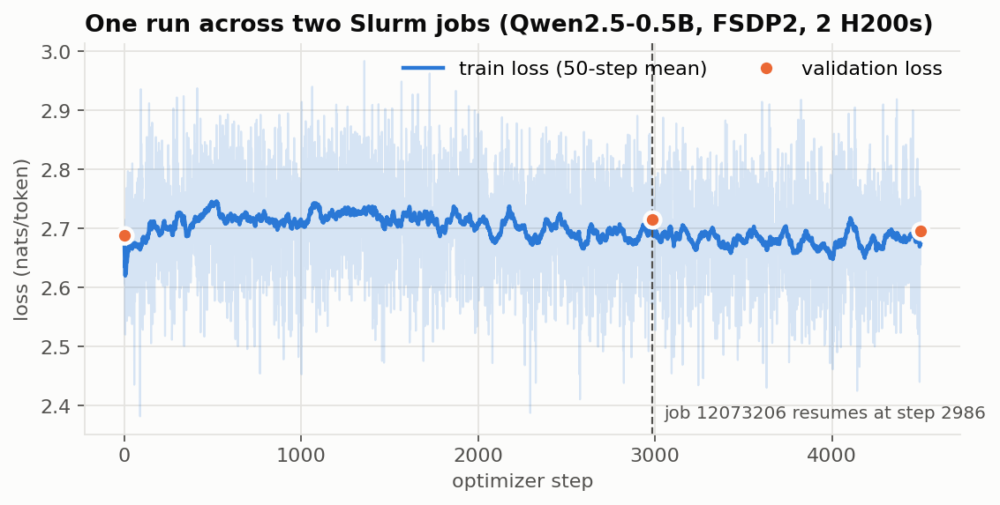
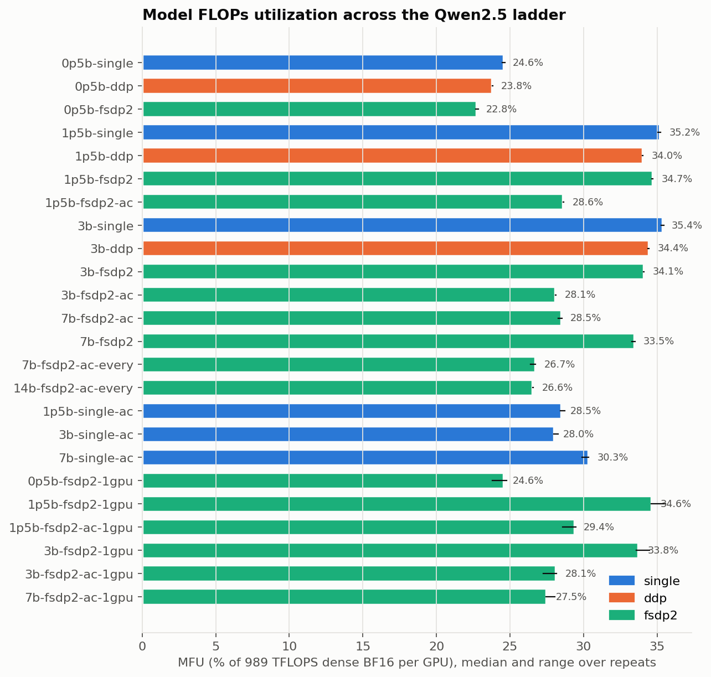
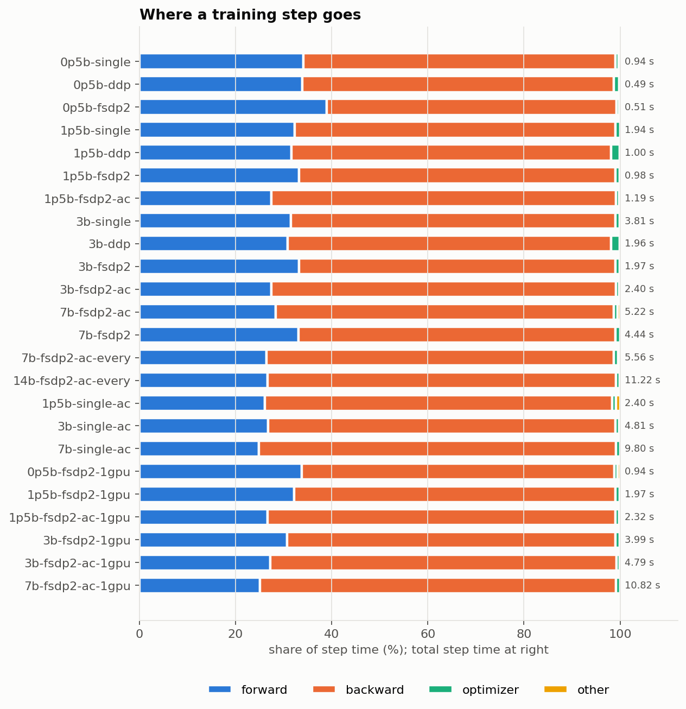
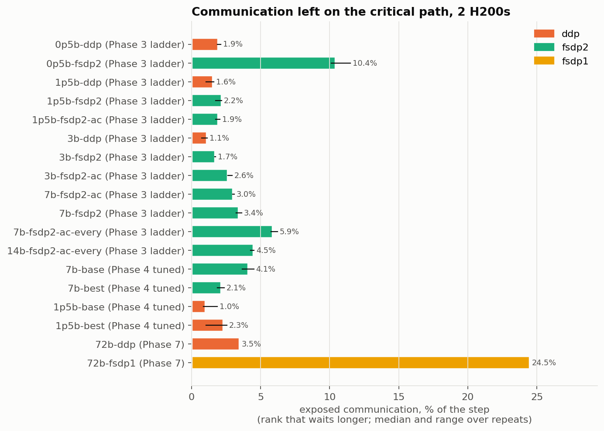
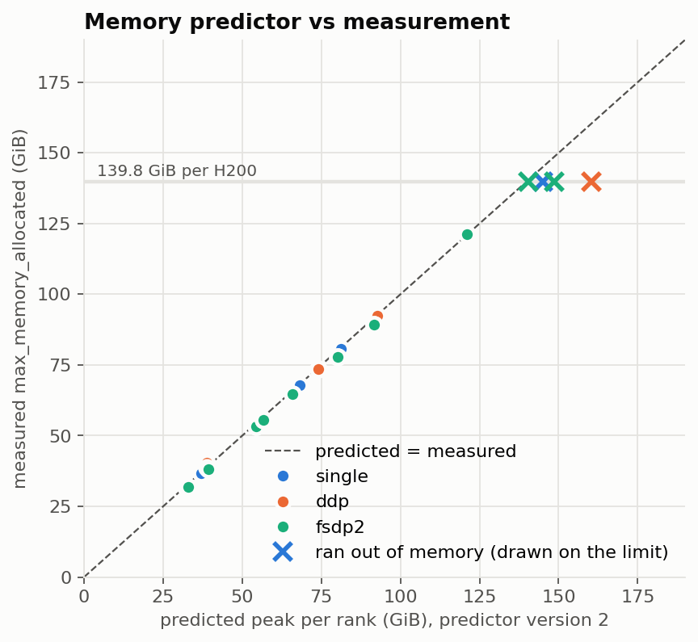
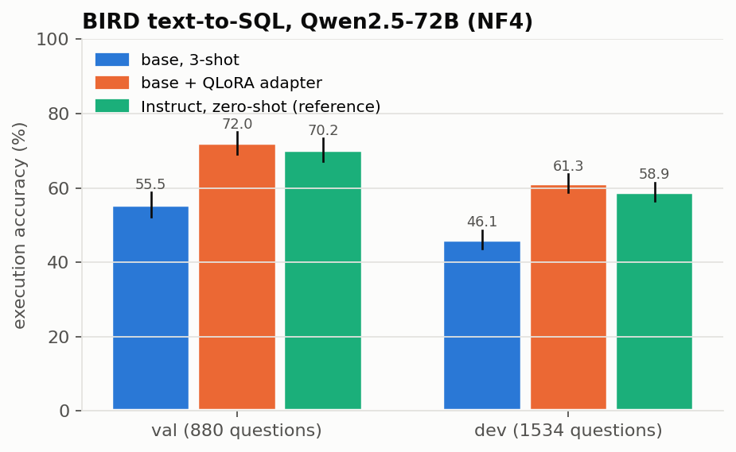
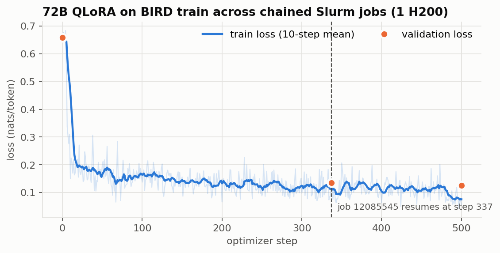
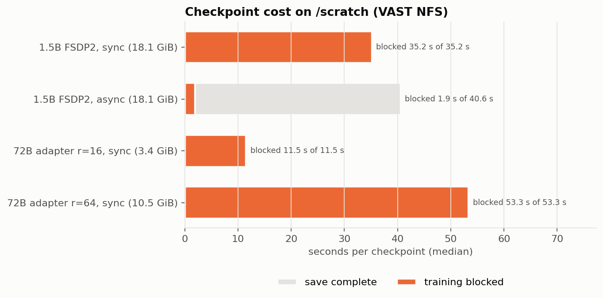

# distributed-llm-training

Distributed LLM training on Northeastern Explorer H200s: a tested DDP/FSDP2 training engine, a
full-parameter scaling and memory study on the Qwen2.5 size ladder, and a Qwen2.5-72B QLoRA fine-tune
evaluated against its base model.

Status: Phases 0-8 and 10 done on 1-2 H200s (the 72B QLoRA fine-tune lifts BIRD dev execution accuracy
from 46.1% to 61.3% on one H200); Phase 9 (4-8 GPUs) needs rented hardware. Plan: [PLAN.md](PLAN.md).
Write-ups: [0 hardware and decisions](docs/phase0.md), [1 environment](docs/phase1.md),
[2 engine](docs/phase2.md), [3 scaling and memory](docs/phase3.md), [4 profiling and tuning](docs/phase4.md),
[5 72B in NF4 and BIRD data](docs/phase5.md), [6 72B QLoRA](docs/phase6.md),
[7 72B replicated vs sharded](docs/phase7.md), [8 fault tolerance](docs/phase8.md),
[10 report: definition of done and the records behind each claim](docs/phase10.md),
[results log](docs/RESULTS_LOG.md).

## Results at a glance

<!-- gen:summary -->
| Result | Number | Details |
|---|---|---|
| Full-parameter training, Qwen2.5 0.5B-14B, 1-2 H200s | up to 35.4% MFU untuned (3b-single); DDP 1->2 GPU scaling 96.7-97.3% | [phase3.md](docs/phase3.md) |
| Profiler-guided tuning, 7B FSDP2 on 2 H200s | +58% tokens/s, 51.6% MFU | [phase4.md](docs/phase4.md) |
| Analytical peak-memory predictor | median error 1.6% on 72 runs, 1.6% out of sample (66 runs) | [phase3.md](docs/phase3.md) |
| Qwen2.5-72B in NF4 vs BF16 | next-token agreement 97.8% on SQL tokens, perplexity gap +0.32% | [phase5.md](docs/phase5.md) |
| 72B QLoRA on one H200, BIRD text-to-SQL | 46.1% -> 61.3% execution accuracy on BIRD dev, +15.2 points (95% CI +12.8 to +17.5) | [phase6.md](docs/phase6.md) |
| 72B QLoRA on 2 H200s, replicated vs sharded | DDP 97.4% scaling at 52.6 GiB per GPU; FSDP1 36.6 GiB per GPU at 68.8% scaling | [phase7.md](docs/phase7.md) |
| Fault tolerance | every injected failure resumes bit-exact; async checkpoints stall 1.9 s instead of 35.2 s per 18 GiB save | [phase8.md](docs/phase8.md) |
<!-- /gen:summary -->

Every table below is generated by `scripts/gen_readme.py` from files in `manifests/` and `results/`;
CI fails if the README drifts from them.

## Hardware

<!-- gen:hardware -->
Probed on d4052 ([manifests/h200.json](manifests/h200.json)).

| Item | Value |
|---|---|
| GPU | NVIDIA H200 |
| Driver | 570.86.15 |
| GPU-GPU link | NV18 |
| BF16 GEMM 8192^3 (median TFLOPS) | 687 |
| Device copy, read + write (median GB/s) | 4,293 |
| Peer copy GPU0 to GPU1 (GB/s) | 395.1 |
<!-- /gen:hardware -->

## NCCL bandwidth

<!-- gen:nccl -->
2 GPUs on d4052, BF16, torch 2.14.1+cu126, NCCL 2.29.3; median of 5 timed repeats (`nccl_bw-12066735-20261122T214613`).

| Size | all_reduce busbw (GB/s) | all_gather busbw (GB/s) | reduce_scatter busbw (GB/s) |
|---|---|---|---|
| 64 KiB | 3.1 | 1.5 | 1.5 |
| 256 KiB | 12.2 | 5.8 | 3.9 |
| 1 MiB | 49.5 | 18.9 | 23.4 |
| 4 MiB | 126.3 | 74.9 | 86.9 |
| 16 MiB | 225.1 | 153.3 | 163.5 |
| 64 MiB | 269.2 | 212.4 | 204.2 |
| 256 MiB | 303.8 | 245.5 | 231.0 |
| 1 GiB | 328.3 | 271.9 | 266.5 |
<!-- /gen:nccl -->

## Smoke runs

Random-init Qwen2.5 trained on one fixed batch per rank (the loss must fall), FP32 parameters with
BF16 autocast, AdamW. Step time is the median after warmup; MFU uses the 989 TFLOPS dense BF16 peak
and the PLAN.md 4.3 FLOP convention.

<!-- gen:smoke -->
| Run | Model | GPUs | Seq x micro-batch | Steps | Loss first -> last | Step (s) | Tokens/s | MFU | Peak alloc (GiB/rank) |
|---|---|---|---|---|---|---|---|---|---|
| `smoke_train-12066735-20261122T214717` | Qwen2.5-0.5B | 2 | 2048 x 4 | 40 | 12.11 -> 0.96 | 0.1135 | 144,379 | 25.5% | 29.1, 28.2 |
| `smoke_train-12066735-20261122T214742` | Qwen2.5-0.5B | 1 | 2048 x 4 | 40 | 12.11 -> 1.54 | 0.1074 | 76,263 | 26.9% | 27.3 |
| `smoke_train-12066735-20261122T215633` | Qwen2.5-0.5B | 2 | 2048 x 4 | 4449 (USR1 at 4449) | 12.11 -> 0.01 | 0.1138 | 143,924 | 25.4% | 29.1, 29.1 |
<!-- /gen:smoke -->

## Engine correctness

Phase 2 checks on 2 H200s with pretrained Qwen2.5-0.5B and FineWeb-Edu
([slurm/phase2_correctness.sbatch](slurm/phase2_correctness.sbatch); the same properties run on CPU in
CI, [tests/test_train_cpu.py](tests/test_train_cpu.py)).

<!-- gen:correctness -->
Parity: Qwen2.5-0.5B, 50 steps, global batch 16 x 2048, micro-batch 4, same data order. Difference is per-step loss against the single-GPU run.

| Run | GPUs | Accum | Loss step 1 -> last | Max abs diff | Max rel diff | Step (s) | Tokens/s | MFU | Peak alloc (GiB) |
|---|---|---|---|---|---|---|---|---|---|
| single | 1 | 4 | 2.6681 -> 2.7690 | reference | reference | 0.4859 | 67,434 | 23.8% | 36.8 |
| ddp | 2 | 2 | 2.6681 -> 2.7688 | 4.7e-04 | 1.7e-04 | 0.2485 | 131,840 | 23.3% | 40.5 |
| fsdp2 | 2 | 2 | 2.6680 -> 2.7689 | 8.0e-04 | 2.9e-04 | 0.2616 | 125,280 | 22.1% | 31.7 |

Resume and crash recovery: deterministic mode, eager attention, 20 steps of 1,024 tokens. "Stop + resume" stops at step 10 with a checkpoint and resumes in a new process; "SIGKILL" kills every rank mid-run with checkpoints every 5 steps and restarts from the latest. Bit-identical means every later per-step loss and gradient norm equals the uninterrupted run's.

| Backend | Stop + resume | SIGKILL, resumed from | Recovery | Checkpoint | Save (s) | Restore (s) |
|---|---|---|---|---|---|---|
| ddp | bit-identical | step 10 | bit-identical | 6.03 GiB | 9.4-11.2 | 13.3-15.6 |
| fsdp2 | bit-identical | step 10 | bit-identical | 6.03 GiB | 14.4-26.8 | 11.3-13.1 |
<!-- /gen:correctness -->

## Training across chained jobs

One run split over two 20-minute Slurm jobs: Slurm's USR1 arrives 300 s before the limit, every rank
stops at the same step and checkpoints, and the next job resumes
([slurm/phase2_chain.sbatch](slurm/phase2_chain.sbatch)).

<!-- gen:chain -->
Qwen2.5-0.5B, fsdp2 on 2 GPUs, 4,500 steps x 32,768 tokens, validation loss on the first 256 held-out sequences.

| Slurm job | Steps | Stopped by | Resumed (restore s) | Checkpoints (step: s) | Tokens/s | Val loss start -> end |
|---|---|---|---|---|---|---|
| 12073205 | 0-2986 | signal | fresh | 1000: 20, 2000: 25, 2986: 16 | 123,666 | 2.6886 -> 2.7151 |
| 12073206 | 2986-4500 | finished | step_00002986 (8) | 3000: 10, 4000: 8, 4500: 8 | 126,759 | - -> 2.6965 |
<!-- /gen:chain -->



## Scaling and memory study (Phase 3)

Qwen2.5 0.5B-14B, full-parameter training on 1 and 2 H200s
([configs/sweeps/p3_ladder.yaml](configs/sweeps/p3_ladder.yaml), run by
[src/dlt/sweep.py](src/dlt/sweep.py)). Pretrained weights, FineWeb-Edu, 2,048-token packed sequences,
global batch 32 sequences (65,536 tokens) per step, FP32 master weights with BF16 compute, AdamW.
Steps 1-5 (warmup) and, on 2 GPUs, 16-17 (profiler) are excluded from timing; tokens are counted after packing, no
padding. MFU counts 6N + 12LdT FLOPs per token against the 989 TFLOPS dense BF16 peak; HFU adds the
recomputed forward when checkpointing is on (PLAN.md 4.3).

<!-- gen:ladder -->
Median over repeats, (min-max) where there are several. Step split and exposed communication are per optimizer step; exposed communication is NCCL kernel time with no compute kernel running, from a 2-step profiler window (max over ranks).

| Run | Model | GPUs | Backend | AC | Micro x accum | Repeats | Tokens/s | MFU | HFU | Fwd / bwd / opt (s) | Exposed comm (s) | Peak alloc (GiB) | Host RSS (GiB) | Load (s) |
|---|---|---|---|---|---|---|---|---|---|---|---|---|---|---|
| 0p5b-single | 0.5B | 1 | single | off | 4 x 8 | 3 | 69,625 (69,345-69,832) | 24.6 (24.5-24.7)% | 24.6% | 0.32/0.61/0.01 | - | 36.8 | 3.5 | 6 |
| 0p5b-ddp | 0.5B | 2 | ddp | off | 4 x 4 | 3 | 134,817 (134,748-135,020) | 23.8 (23.8-23.8)% | 23.8% | 0.16/0.32/0.01 | 0.009 (0.009-0.010) | 38.7 | 3.9 | 5 |
| 0p5b-fsdp2 | 0.5B | 2 | fsdp2 | off | 4 x 4 | 3 | 128,914 (128,421-129,482) | 22.8 (22.7-22.9)% | 22.8% | 0.20/0.31/0.00 | 0.053 (0.052-0.059) | 31.8 | 2.3 | 4 |
| 1p5b-single | 1.5B | 1 | single | off | 4 x 8 | 3 | 33,744 (33,592-33,788) | 35.2 (35.0-35.2)% | 35.2% | 0.63/1.30/0.02 | - | 67.7 | 9.4 | 8 |
| 1p5b-ddp | 1.5B | 2 | ddp | off | 4 x 4 | 3 | 65,234 (65,132-65,271) | 34.0 (34.0-34.1)% | 34.0% | 0.32/0.67/0.02 | 0.016 (0.011-0.016) | 73.5 | 9.8 | 5 |
| 1p5b-fsdp2 | 1.5B | 2 | fsdp2 | off | 4 x 4 | 3 | 66,534 (66,358-66,546) | 34.7 (34.6-34.7)% | 34.7% | 0.33/0.65/0.01 | 0.021 (0.017-0.022) | 53.3 | 2.8 | 4 |
| 1p5b-fsdp2-ac | 1.5B | 2 | fsdp2 | on | 4 x 4 | 3 | 54,877 (54,854-54,909) | 28.6 (28.6-28.6)% | 38.2% | 0.33/0.86/0.01 | 0.023 (0.021-0.024) | 31.9 | 2.8 | 4 |
| 3b-single | 3B | 1 | single | off | 2 x 16 | 3 | 17,216 (17,172-17,257) | 35.4 (35.3-35.5)% | 35.4% | 1.20/2.57/0.04 | - | 80.8 | 18.0 | 12 |
| 3b-ddp | 3B | 2 | ddp | off | 2 x 8 | 3 | 33,509 (33,437-33,519) | 34.4 (34.4-34.4)% | 34.4% | 0.60/1.32/0.04 | 0.022 (0.015-0.022) | 92.3 | 18.4 | 7 |
| 3b-fsdp2 | 3B | 2 | fsdp2 | off | 2 x 8 | 3 | 33,188 (33,160-33,194) | 34.1 (34.1-34.1)% | 34.1% | 0.66/1.30/0.02 | 0.034 (0.033-0.034) | 55.5 | 3.2 | 6 |
| 3b-fsdp2-ac | 3B | 2 | fsdp2 | on | 2 x 8 | 3 | 27,345 (27,332-27,353) | 28.1 (28.1-28.1)% | 37.5% | 0.66/1.72/0.02 | 0.063 (0.063-0.071) | 38.3 | 3.2 | 6 |
| 7b-fsdp2-ac | 7B | 2 | fsdp2 | on | 1 x 16 | 3 | 12,558 (12,463-12,581) | 28.5 (28.3-28.5)% | 38.0% | 1.48/3.67/0.05 | 0.157 (0.156-0.162) | 77.7 | 3.9 | 8 |
| 7b-fsdp2 | 7B | 2 | fsdp2 | off | 1 x 16 | 3 | 14,745 (14,669-14,760) | 33.5 (33.3-33.5)% | 33.5% | 1.47/2.93/0.05 | 0.151 (0.143-0.163) | 89.4 | 3.9 | 8 |
| 7b-fsdp2-ac-every | 7B | 2 | fsdp2 (sync every) | on | 1 x 16 | 3 | 11,779 (11,631-11,781) | 26.7 (26.4-26.7)% | 35.6% | 1.47/4.02/0.05 | 0.332 (0.321-0.346) | 64.6 | 3.9 | 9 |
| 14b-fsdp2-ac-every | 14B | 2 | fsdp2 (sync every) | on | 1 x 16 | 3 | 5,839 (5,831-5,840) | 26.6 (26.5-26.6)% | 35.4% | 2.99/8.13/0.09 | 0.503 (0.479-0.509) | 121.2 | 5.0 | 32 |
| 1p5b-single-ac | 1.5B | 1 | single | on | 4 x 8 | 3 | 27,310 (27,239-27,526) | 28.5 (28.4-28.7)% | 38.0% | 0.63/1.73/0.02 | - | 41.2 | 9.4 | 31 |
| 3b-single-ac | 3B | 1 | single | on | 2 x 16 | 3 | 13,623 (13,612-13,763) | 28.0 (28.0-28.3)% | 37.3% | 1.29/3.47/0.04 | - | 56.0 | 18.0 | 15 |
| 7b-single-ac | 7B | 1 | single | on | 1 x 32 | 3 | 6,685 (6,587-6,690) | 30.3 (29.9-30.4)% | 40.5% | 2.44/7.28/0.09 | - | 129.2 | 43.4 | 18 |
| 0p5b-fsdp2-1gpu | 0.5B | 1 | fsdp2 | off | 4 x 8 | 3 | 69,579 (67,350-70,154) | 24.6 (23.8-24.8)% | 24.6% | 0.32/0.61/0.01 | - | 34.5 | 2.1 | 9 |
| 1p5b-fsdp2-1gpu | 1.5B | 1 | fsdp2 | off | 4 x 8 | 3 | 33,202 (33,148-34,085) | 34.6 (34.6-35.6)% | 34.6% | 0.64/1.32/0.02 | - | 62.0 | 4.1 | 8 |
| 1p5b-fsdp2-ac-1gpu | 1.5B | 1 | fsdp2 | on | 4 x 8 | 3 | 28,191 (27,381-28,240) | 29.4 (28.6-29.5)% | 39.2% | 0.62/1.68/0.02 | - | 40.5 | 4.1 | 8 |
| 3b-fsdp2-1gpu | 3B | 1 | fsdp2 | off | 2 x 16 | 3 | 16,423 (16,337-16,777) | 33.8 (33.6-34.5)% | 33.8% | 1.23/2.73/0.04 | - | 72.7 | 5.0 | 11 |
| 3b-fsdp2-ac-1gpu | 3B | 1 | fsdp2 | on | 2 x 16 | 3 | 13,693 (13,268-13,700) | 28.1 (27.3-28.2)% | 37.5% | 1.30/3.45/0.04 | - | 55.4 | 5.0 | 9 |
| 7b-fsdp2-ac-1gpu | 7B | 1 | fsdp2 | on | 1 x 32 | 3 | 6,059 (6,047-6,181) | 27.5 (27.5-28.1)% | 36.7% | 2.72/8.01/0.09 | - | 122.6 | 6.6 | 11 |
<!-- /gen:ladder -->







Exposed communication is NCCL kernel time with no compute kernel running, per step, from the profiler; it includes time one rank spends waiting for the other (most of the 72B DDP figure and nearly all of the 72B FSDP1 one, see [docs/phase7.md](docs/phase7.md)).

### Scaling from 1 to 2 GPUs

<!-- gen:scaling -->
Scaling efficiency = tokens/s on 2 GPUs / (2 x tokens/s on 1 GPU), same model, data, sequence length, global batch, activation checkpointing and precision mechanism (medians over repeats). DDP is compared with the single-GPU run (both BF16 autocast over FP32 weights); FSDP2 with FSDP2 on 1 GPU (BF16 parameter casts). A row marked * compares FSDP2 against the autocast single-GPU run because no 1-GPU FSDP2 run exists, which mixes two precision mechanisms.

| Model | 1-GPU run | 2-GPU run | 1 GPU tokens/s | 2 GPU tokens/s | Efficiency |
|---|---|---|---|---|---|
| 0.5B | 0p5b-single | 0p5b-ddp | 69,625 | 134,817 | 96.8% |
| 0.5B | 0p5b-fsdp2-1gpu | 0p5b-fsdp2 | 69,579 | 128,914 | 92.6% |
| 1.5B | 1p5b-single | 1p5b-ddp | 33,744 | 65,234 | 96.7% |
| 1.5B | 1p5b-fsdp2-1gpu | 1p5b-fsdp2 | 33,202 | 66,534 | 100.2% |
| 1.5B | 1p5b-fsdp2-ac-1gpu | 1p5b-fsdp2-ac | 28,191 | 54,877 | 97.3% |
| 3B | 3b-single | 3b-ddp | 17,216 | 33,509 | 97.3% |
| 3B | 3b-fsdp2-1gpu | 3b-fsdp2 | 16,423 | 33,188 | 101.0% |
| 3B | 3b-fsdp2-ac-1gpu | 3b-fsdp2-ac | 13,693 | 27,345 | 99.9% |
| 7B | 7b-fsdp2-ac-1gpu | 7b-fsdp2-ac | 6,059 | 12,558 | 103.6% |
| 7B | none (does not fit on 1 GPU) | 7b-fsdp2 | - | 14,745 | n/a; MFU 33.5% |
| 7B | none (does not fit on 1 GPU) | 7b-fsdp2-ac-every | - | 11,779 | n/a; MFU 26.7% |
| 14B | none (does not fit on 1 GPU) | 14b-fsdp2-ac-every | - | 5,839 | n/a; MFU 26.6% |
<!-- /gen:scaling -->

### Memory: predicted vs measured

<!-- gen:memory -->
Predicted peak allocated memory per rank (dlt.metrics.memory, analytical, not fitted) against the measured `max_memory_allocated` (max over ranks), for every run including OOMs. Limit: 139.8 GiB visible per H200. "Now" is predictor version 3; "at run time" is the version the run recorded (version 1 double-counted FSDP2 gradients under no-sync accumulation; version 2 kept autocast weight copies until backward under checkpointing).

Over 72 finished runs: median absolute error 1.6%, worst 4.0% (at run time: median absolute error 2.1%, worst 21.3%); fit vs OOM predicted correctly for 28 of 28 configurations.

| Run | Predicted now (GiB) | At run time (GiB) | Measured (GiB) | Error now | Outcome |
|---|---|---|---|---|---|
| 0p5b-single | 37.0 | 37.0 | 36.8 | +0.6% | fit (predicted fit) |
| 0p5b-ddp | 38.9 | 38.9 | 38.7 | +0.6% | fit (predicted fit) |
| 0p5b-fsdp2 | 32.1 | 33.0 | 31.8 | +1.1% | fit (predicted fit) |
| 1p5b-single | 68.3 | 68.3 | 67.7 | +0.8% | fit (predicted fit) |
| 1p5b-ddp | 74.0 | 74.0 | 73.5 | +0.7% | fit (predicted fit) |
| 1p5b-fsdp2 | 54.3 | 57.2 | 53.3 | +1.9% | fit (predicted fit) |
| 1p5b-fsdp2-ac | 33.0 | 35.9 | 31.9 | +3.7% | fit (predicted fit) |
| 3b-single | 81.2 | 81.2 | 80.8 | +0.5% | fit (predicted fit) |
| 3b-ddp | 92.7 | 92.7 | 92.3 | +0.4% | fit (predicted fit) |
| 3b-fsdp2 | 56.6 | 62.4 | 55.5 | +2.0% | fit (predicted fit) |
| 3b-fsdp2-ac | 39.3 | 45.0 | 38.3 | +2.7% | fit (predicted fit) |
| probe-7b-single | 145.1 | 145.1 | OOM during step:1 | - | predicted OOM |
| 7b-fsdp2-ac | 80.1 | 94.3 | 77.7 | +3.0% | fit (predicted fit) |
| 7b-fsdp2 | 91.7 | 105.8 | 89.4 | +2.6% | fit (predicted fit) |
| 7b-fsdp2-ac-every | 65.9 | 65.9 | 64.6 | +2.0% | fit (predicted fit) |
| 14b-fsdp2-ac-every | 121.0 | 121.0 | 121.2 | -0.2% | fit (predicted fit) |
| probe-7b-ddp-ac | 156.4 | 160.4 | OOM during step:0 | - | predicted OOM |
| probe-14b-fsdp2-ac-last | 148.5 | 176.0 | OOM during step:1 | - | predicted OOM |
| probe-14b-fsdp2-every | 140.5 | 140.5 | OOM during step:1 | - | predicted OOM |
| 1p5b-single-ac | 42.0 | 44.5 | 41.2 | +2.0% | fit (predicted fit) |
| 3b-single-ac | 56.5 | 61.6 | 56.0 | +0.9% | fit (predicted fit) |
| 7b-single-ac | 128.1 | 132.1 | 129.2 | -0.9% | fit (predicted fit) |
| 0p5b-fsdp2-1gpu | 34.9 | 34.9 | 34.5 | +1.1% | fit (predicted fit) |
| 1p5b-fsdp2-1gpu | 62.9 | 62.9 | 62.0 | +1.6% | fit (predicted fit) |
| 1p5b-fsdp2-ac-1gpu | 41.7 | 41.7 | 40.5 | +2.9% | fit (predicted fit) |
| 3b-fsdp2-1gpu | 73.9 | 73.9 | 72.7 | +1.7% | fit (predicted fit) |
| 3b-fsdp2-ac-1gpu | 56.5 | 56.5 | 55.4 | +2.1% | fit (predicted fit) |
| 7b-fsdp2-ac-1gpu | 122.6 | 122.6 | 122.6 | +0.0% | fit (predicted fit) |

Out of sample, on the 66 Phase 4 runs (configurations the corrections never saw: larger micro-batches, chunked loss, longer sequences, other kernels): median absolute error 1.6%, worst 7.1% (worst: 1p5b-bucket-view).
<!-- /gen:memory -->



### Activation checkpointing

<!-- gen:ac -->
Same model, backend, GPUs and micro-batch, checkpointing every decoder layer on vs off (medians).

| Model | GPUs | Backend | Peak off -> on (GiB) | Memory saved | Tokens/s off -> on | Throughput cost |
|---|---|---|---|---|---|---|
| 1.5B | 2 | fsdp2 | 53.3 -> 31.9 | 40% | 66,534 -> 54,877 | 17.5% |
| 3B | 2 | fsdp2 | 55.5 -> 38.3 | 31% | 33,188 -> 27,345 | 17.6% |
| 7B | 2 | fsdp2 | 89.4 -> 77.7 | 13% | 14,745 -> 12,558 | 14.8% |
| 1.5B | 1 | single | 67.7 -> 41.2 | 39% | 33,744 -> 27,310 | 19.1% |
| 3B | 1 | single | 80.8 -> 56.0 | 31% | 17,216 -> 13,623 | 20.9% |
| 1.5B | 1 | fsdp2 | 62.0 -> 40.5 | 35% | 33,202 -> 28,191 | 15.1% |
| 3B | 1 | fsdp2 | 72.7 -> 55.4 | 24% | 16,423 -> 13,693 | 16.6% |
<!-- /gen:ac -->

## Profiling and tuning (Phase 4)

Qwen2.5-7B with FSDP2 and Qwen2.5-1.5B with DDP, both on 2 H200s, one change at a time
([configs/sweeps/p4_tuning.yaml](configs/sweeps/p4_tuning.yaml)); Nsight Systems on each baseline
([slurm/nsys_2gpu.sbatch](slurm/nsys_2gpu.sbatch)).

<!-- gen:tuning -->
Each change against its workload's baseline, both run 3 times in the same sweep. Change is the median tokens/s against the baseline median; "noise" marks a change whose min-max range overlaps the baseline's. GPU idle is time inside the profiled steps with no kernel running.

**Round p4**: one change at a time, configs/sweeps/p4_tuning.yaml.

| Run | Tokens/s | Change | MFU | Peak alloc (GiB) | Fwd / bwd / opt (s) | Exposed comm (s) | GPU idle (s) |
|---|---|---|---|---|---|---|---|
| 7b-base | 14,570 (14,541-14,570) | baseline | 33.1% | 89.4 | 1.49/2.96/0.05 | 0.146 | 0.178 |
| 7b-no-reshard | 15,996 (15,968-16,001) | +9.8% | 36.3% | 101.6 | 1.49/2.57/0.05 | 0.140 | 0.154 |
| 7b-prefetch2 | 14,674 (14,644-14,674) | +0.7% | 33.3% | 89.4 | 1.48/2.94/0.05 | 0.164 | 0.170 |
| 7b-micro2 | 17,527 (17,526-17,540) | +20.3% | 39.8% | 105.4 | 1.21/2.48/0.05 | 0.069 | 0.108 |
| 7b-micro2-chunk | 17,020 (17,020-17,025) | +16.8% | 38.6% | 100.8 | 1.21/2.60/0.05 | 0.070 | 0.116 |
| 7b-chunk | 14,287 (14,276-14,310) | -1.9% | 32.4% | 88.8 | 1.49/3.05/0.05 | 0.177 | 0.182 |
| 7b-sdpa-flash | 14,640 (14,623-14,648) | +0.5% | 33.2% | 89.4 | 1.48/2.94/0.05 | 0.174 | 0.179 |
| 7b-sdpa-cudnn | 14,950 (14,923-14,967) | +2.6% | 33.9% | 89.4 | 1.45/2.89/0.05 | 0.164 | 0.167 |
| 7b-sdpa-efficient | 14,009 (14,002-14,013) | -3.8% | 31.8% | 89.4 | 1.51/3.12/0.05 | 0.168 | 0.176 |
| 7b-ac-every2 | 13,529 (13,522-13,552) | -7.1% | 30.7% | 83.5 | 1.48/3.32/0.05 | 0.185 | 0.231 |
| 7b-seq4096 | 16,875 (16,872-16,885) | +15.8% | 40.4% | 105.4 | 1.25/2.59/0.05 | 0.071 | 0.112 |
| 1p5b-base | 65,074 (64,993-65,178) | baseline | 34.0% | 73.5 | 0.31/0.67/0.02 | 0.010 | 0.049 |
| 1p5b-bucket5 | 65,212 (65,080-65,266) | +0.2% (noise) | 34.0% | 73.5 | 0.31/0.67/0.02 | 0.009 | 0.046 |
| 1p5b-bucket100 | 65,268 (65,102-65,304) | +0.3% (noise) | 34.1% | 73.5 | 0.31/0.67/0.02 | 0.010 | 0.046 |
| 1p5b-bucket-view | 65,373 (65,212-65,402) | +0.5% | 34.1% | 73.5 | 0.31/0.67/0.02 | 0.008 | 0.045 |
| 1p5b-micro8 | 68,230 (68,155-68,274) | +4.8% | 35.6% | 115.2 | 0.30/0.64/0.02 | 0.009 | 0.027 |
| 1p5b-micro8-chunk | 64,248 (64,209-64,274) | -1.3% | 33.5% | 90.3 | 0.30/0.70/0.02 | 0.009 | 0.028 |
| 1p5b-chunk | 61,351 (61,343-61,382) | -5.7% | 32.0% | 64.7 | 0.32/0.73/0.02 | 0.009 | 0.049 |
| 1p5b-sdpa-flash | 65,108 (65,102-65,214) | +0.1% (noise) | 34.0% | 73.5 | 0.31/0.67/0.02 | 0.008 | 0.046 |
| 1p5b-sdpa-cudnn | 67,252 (67,198-67,288) | +3.3% | 35.1% | 73.5 | 0.30/0.65/0.02 | 0.010 | 0.049 |
| 1p5b-sdpa-efficient | 59,894 (59,805-60,084) | -8.0% | 31.2% | 73.5 | 0.33/0.74/0.02 | 0.008 | 0.046 |
| 1p5b-seq4096 | 60,697 (60,611-60,721) | -6.7% | 34.9% | 73.5 | 0.34/0.73/0.02 | 0.010 | 0.048 |

**Round p4b**: the two fixes the Nsight profiles pointed to, configs/sweeps/p4b_fusion.yaml.

| Run | Tokens/s | Change | MFU | Peak alloc (GiB) | Fwd / bwd / opt (s) | Exposed comm (s) | GPU idle (s) |
|---|---|---|---|---|---|---|---|
| 7b-base | 14,521 (14,429-14,524) | baseline | 33.0% | 89.4 | 1.48/2.98/0.05 | 0.133 | 0.167 |
| 7b-hold | 18,014 (18,014-18,018) | +24.1% | 40.9% | 101.6 | 1.02/2.57/0.05 | 0.022 | 0.150 |
| 7b-compile | 16,263 (16,263-16,273) | +12.0% | 36.9% | 85.8 | 1.32/2.66/0.05 | 0.131 | 0.065 |
| 7b-compile-hold | 20,278 (20,276-20,310) | +39.6% | 46.0% | 98.0 | 0.87/2.32/0.05 | 0.019 | 0.071 |
| 1p5b-base | 64,606 (64,393-64,770) | baseline | 33.7% | 73.5 | 0.32/0.68/0.02 | 0.014 | 0.047 |
| 1p5b-compile | 81,277 (81,010-81,315) | +25.8% | 42.4% | 69.5 | 0.26/0.53/0.02 | 0.006 | 0.027 |

**Round p4c**: the changes that paid off, combined, configs/sweeps/p4c_combined.yaml.

| Run | Tokens/s | Change | MFU | Peak alloc (GiB) | Fwd / bwd / opt (s) | Exposed comm (s) | GPU idle (s) |
|---|---|---|---|---|---|---|---|
| 7b-base | 14,384 (14,380-14,438) | baseline | 32.6% | 89.4 | 1.50/3.01/0.05 | 0.187 | 0.177 |
| 7b-best | 22,720 (22,716-22,755) | +58.0% | 51.6% | 110.5 | 0.86/1.98/0.05 | 0.062 | 0.047 |
| 7b-best-flash | 22,765 (22,752-22,771) | +58.3% | 51.7% | 110.5 | 0.86/1.97/0.05 | 0.057 | 0.047 |
| 1p5b-base | 64,295 (64,266-64,376) | baseline | 33.5% | 73.5 | 0.32/0.68/0.02 | 0.010 | 0.049 |
| 1p5b-best | 87,692 (87,527-87,862) | +36.4% | 45.8% | 107.4 | 0.25/0.48/0.02 | 0.017 | 0.016 |
| 1p5b-best-flash | 84,455 (84,428-84,777) | +31.4% | 44.1% | 107.4 | 0.25/0.50/0.02 | 0.007 | 0.017 |
<!-- /gen:tuning -->

<!-- gen:profile -->
Nsight Systems, rank 0, GPU kernel time per optimizer step by category (share of kernel time), over the captured steps ([scripts/nsys_summary.py](scripts/nsys_summary.py)). NCCL kernel time includes time spent waiting for the other rank.

| Run | GEMM | attention | NCCL | elementwise + reduce | cross-entropy | optimizer + clip | FSDP2 copies | other | Exposed comm (s) | GPU idle (s) |
|---|---|---|---|---|---|---|---|---|---|---|
| p4-nsys-7b-base | 2.128 (35%) | 0.276 (4%) | 1.524 (25%) | 1.344 (22%) | 0.040 (1%) | 0.558 (9%) | 0.246 (4%) | 0.025 (0%) | 0.297 | 0.156 |
| p4-nsys-1p5b-base | 0.411 (34%) | 0.094 (8%) | 0.254 (21%) | 0.400 (33%) | 0.039 (3%) | 0.018 (1%) | 0.000 (0%) | 0.008 (1%) | 0.119 | 0.043 |
<!-- /gen:profile -->

## Qwen2.5-72B in NF4 (Phase 5)

<!-- gen:nf4 -->
Qwen2.5-72B at `efba10c8e5`. Tokenizer: special-token ids correct, 0 round-trip failures over 200 example texts, vocabulary identical to Qwen2.5-0.5B's.

| Load path | GPUs | Load (s) | Peak GPU memory (GiB) | Host RSS (GiB) |
|---|---|---|---|---|
| BF16 checkpoint, quantized to NF4 while loading | 1 | 391 | 38.8 | 136.4 |
| saved NF4 checkpoint (38.4 GiB on disk) | 1 | 114 | 66.2 | - |
| BF16, layers split over 2 GPUs | 2 | 329 | 71.3, 68.6 | 136.3 |
| NF4 forward pass | 1 | 14 | 42.0 | 39.2 |

NF4 vs BF16, teacher-forced over 200 validation questions (301,661 positions, 12,133 in the SQL): the argmax next token agrees at 93.44% of positions (97.81% in the SQL); perplexity of the gold SQL 1.9367 (NF4) vs 1.9305 (BF16), a +0.32% gap (+0.68% over all tokens).
<!-- /gen:nf4 -->

## 72B QLoRA on BIRD text-to-SQL (Phases 6-7)

<!-- gen:bird -->
Execution accuracy (EX): the predicted SQL returns the same set of rows as the gold SQL on the database (BIRD's official criterion), 95% bootstrap CI over questions. Same schema text, greedy decoding and scorer for every model; the base model gets 3 worked examples from other databases, the fine-tuned model none; the Instruct model (NF4, chat template) is a reference, not a baseline. "val" is the database-level holdout from BIRD train; "dev" is BIRD dev (1106 split).

| Run | Model | Split | Questions | EX | 95% CI | Simple / moderate / challenging |
|---|---|---|---|---|---|---|
| base-dev | base | dev | 1534 | 46.1% | 43.6-48.6 | 56.9 / 38.6 / 20.3 |
| finetuned-dev | finetuned | dev | 1534 | 61.3% | 58.9-63.7 | 70.6 / 58.0 / 32.9 |
| finetuned-dev-repro | finetuned | dev | 1534 | 61.3% | 58.9-63.7 | 70.6 / 58.0 / 32.9 |
| instruct-dev | instruct | dev | 1534 | 58.9% | 56.5-61.4 | 70.2 / 53.3 / 27.7 |
| base-val | base | val | 880 | 55.5% | 52.2-58.8 | - |
| finetuned-val | finetuned | val | 880 | 72.0% | 69.1-75.0 | - |
| instruct-val | instruct | val | 880 | 70.2% | 67.2-73.3 | - |

Fine-tuned minus base on val (880 questions, paired bootstrap): +16.6 points, 95% CI +13.5 to +19.7.

Fine-tuned minus Instruct (reference) on val (880 questions, paired bootstrap): +1.8 points, 95% CI -0.7 to +4.2.

Fine-tuned minus base on dev (1534 questions, paired bootstrap): +15.2 points, 95% CI +12.8 to +17.5.

Fine-tuned minus Instruct (reference) on dev (1534 questions, paired bootstrap): +2.3 points, 95% CI +0.2 to +4.5.

Repeat of finetuned-dev in a fresh process (finetuned-dev-repro): 1534 of 1534 questions scored the same.
<!-- /gen:bird -->



<!-- gen:qlora -->
72B QLoRA training runs (one record per Slurm job). Tokens are real tokens (prompt + SQL, no padding); MFU uses the QLoRA convention 4N + 12LdT (PLAN.md 4.3).

| Run | Backend x GPUs | r | Steps | Stopped by | Loss first -> last | Val loss | Tokens/s | MFU | Peak GPU (GiB) | Audit |
|---|---|---|---|---|---|---|---|---|---|---|
| p6-overfit | single x 1 | 16 | 0-120 | finished | 0.709 -> 0.000 | - | 944 | 28.7% | 47.6 | 210.5M LoRA params, base unchanged |
| p6.r16.r0 | single x 1 | 16 | 0-40 | finished | 0.672 -> 0.116 | 0.1531 | 905 | 27.3% | 51.9 | 210.5M LoRA params, base unchanged |
| p8-72b-resume-then-term | single x 1 | 16 | 10-18 | signal | 0.157 -> 0.281 | - | 901 | 27.2% | 51.5 | 210.5M LoRA params, base unchanged |
| p8-72b-final | single x 1 | 16 | 18-24 | finished | 0.146 -> 0.177 | - | 931 | 28.1% | 51.8 | 210.5M LoRA params, base unchanged |
| p6.r64.r0 | single x 1 | 64 | 0-40 | finished | 0.672 -> 0.110 | 0.1466 | 904 | 27.3% | 61.4 | 842.1M LoRA params, base unchanged |
| p6.r16-len2048.r0 | single x 1 | 16 | 0-40 | finished | 0.644 -> 0.175 | 0.1537 | 836 | 24.9% | 47.6 | 210.5M LoRA params, base unchanged |
| p6.r16-sdpa-efficient.r0 | single x 1 | 16 | 0-40 | finished | 0.673 -> 0.116 | 0.1511 | 867 | 26.2% | 51.9 | 210.5M LoRA params, base unchanged |
| p6-main | single x 1 | 64 | 0-337 | signal | 0.672 -> 0.132 | 0.1347 | 873 | 26.3% | 61.7 | 842.1M LoRA params, base unchanged |
| p6-main | single x 1 | 64 | 337-500 | finished | 0.130 -> 0.058 | 0.1255 | 874 | 26.3% | 61.7 | 842.1M LoRA params, base unchanged |
| p7.72b-single.r0 | single x 1 | 16 | 0-20 | finished | 0.672 -> 0.167 | - | 891 | 26.9% | 51.8 | 210.5M LoRA params, base unchanged |
| p7.72b-ddp.r0 | ddp x 2 | 16 | 0-20 | finished | 0.672 -> 0.165 | - | 1,735 | 26.2% | 52.4, 52.6 | 210.5M LoRA params, base unchanged |
| p7.72b-fsdp1.r0 | fsdp1 x 2 | 16 | 0-20 | finished | 0.672 -> 0.164 | - | 1,226 | 18.5% | 36.4, 36.6 | 210.5M LoRA params, base unchanged |
<!-- /gen:qlora -->



### 72B on 2 GPUs: replicated vs sharded (Phase 7)

<!-- gen:p7 -->
Qwen2.5-72B NF4 + LoRA r=16, 16 BIRD questions per step, activation checkpointing, 20 steps, the same data order on every run. Scaling = 2-GPU tokens/s over twice the 1-GPU tokens/s. Exposed communication: NCCL kernel time with no compute kernel running, per step, from the profiler (steps 12-13). Loss difference: largest relative gap to the 1-GPU run's per-step loss.

| Run | GPUs | Tokens/s | Scaling | MFU | Median step | Peak GPU allocated / reserved per rank (GiB) | Exposed comm per step, by rank | Loss vs 1 GPU |
|---|---|---|---|---|---|---|---|---|
| 72b-single | 1 | 891 | - | 26.9% | 28.33 s | 51.8 / 96.5 | - | - |
| 72b-ddp | 2 | 1,735 | 97.4% | 26.2% | 15.17 s | 52.4 / 62.6, 52.6 / 68.6 | 0.53 s, 0.00 s | 1.48% |
| 72b-fsdp1 | 2 | 1,226 | 68.8% | 18.5% | 20.40 s | 36.4 / 96.9, 36.6 / 99.9 | 4.76 s, 5.00 s | 1.97% |
<!-- /gen:p7 -->

## Fault tolerance (Phase 8)

<!-- gen:faults -->
Qwen2.5-1.5B, FSDP2 on 2 H200s, deterministic mode, checkpoints every 10 steps. "Matches" means every per-step loss after the resume equals the uninterrupted run's. Lost steps are the steps recomputed after the resume; their time is lost steps x the median step, plus the restart.

| Failure | Resumed from | Lost steps (s) | Restart: load + restore (s) | Matches uninterrupted |
|---|---|---|---|---|
| SIGKILL mid-step (before step 25) | step 20 | 5 (1.9) | 9 + 30 | yes |
| SIGKILL after writing, before publishing, the step-30 checkpoint | step 20 | 10 (3.9) | 16 + 6 | yes |
| SIGTERM with stop_on_term (before step 25) | step 26 | 0 (0.0) | 15 + 44 | yes |
| SIGTERM, default action (before step 25) | step 20 | 5 (1.9) | 16 + 50 | yes |
| SIGKILL during the end-of-run evaluation | the final checkpoint; the next link finds the run complete and exits | 0 (only the evaluation) | - | - |

| Checkpoint | Size (GiB) | Training blocked per save (s) | Save complete (s) | Median step (s) |
|---|---|---|---|---|
| synchronous DCP | 18.1 | 35.2 | 35.2 | 0.390 |
| DCP async_save | 18.1 | 1.9 | 40.6 | 0.378 |
<!-- /gen:faults -->



## Layout

| Path | What |
|---|---|
| `src/dlt/train/` | the training engine: single GPU, DDP, FSDP2, FSDP1 for sharded QLoRA; LoRA on NF4; DCP checkpoints (sync and async); sharded loading |
| `src/dlt/data/` | packed pretraining tokens, SFT examples, the deterministic data order |
| `src/dlt/metrics/` | FLOPs and MFU, the peak-memory predictor, communication overlap from kernel timelines |
| `src/dlt/bird/` | BIRD preparation, prompts, generation and execution-accuracy scoring |
| `src/dlt/qlora/` | 72B NF4 quantization and the NF4-vs-BF16 check |
| `src/dlt/sweep.py` | runs a sweep file inside one Slurm allocation, resumable |
| `configs/` | training configs and sweep files, one per study |
| `slurm/` | job scripts: 1- and 2-GPU templates, sweeps, chained runs, Nsight, fault injection, data and model preparation |
| `scripts/` | README and figure generation, result import, Nsight summaries, probes |
| `results/` | one JSON record per run, the only source of numbers in this README; `invalid.json` lists records a bug invalidated |
| `manifests/` | hardware manifest and scrubbed raw probe output |
| `docs/` | one write-up per phase and [docs/RESULTS_LOG.md](docs/RESULTS_LOG.md) (failures, dead ends, fixes) |

## Running on Explorer

```bash
# once per lockfile: build the venv on a CPU node; fetch pinned weights (verified checksums); prepare data
sbatch slurm/setup_env.sbatch
sbatch slurm/fetch_models.sbatch --verify Qwen/Qwen2.5-72B
sbatch slurm/tokenize.sbatch
sbatch slurm/bird_prep.sbatch
# Phases 1-2: checks, engine correctness, a run across chained jobs
sbatch slurm/phase1_smoke.sbatch
sbatch slurm/phase2_correctness.sbatch
slurm/chain.sh 2 slurm/phase2_chain.sbatch
# Phases 3-4: sweeps run inside one allocation and skip finished runs
sbatch slurm/sweep_2gpu.sbatch configs/sweeps/p3_ladder.yaml
sbatch slurm/sweep_2gpu.sbatch configs/sweeps/p4c_combined.yaml
sbatch slurm/nsys_2gpu.sbatch p4-nsys-7b-base --config configs/training/p4_7b_fsdp2.yaml
# Phases 5-7: 72B NF4, QLoRA on BIRD, evaluation, replicated vs sharded
sbatch slurm/phase5_nf4.sbatch
sbatch slurm/h200_1gpu.sbatch dlt.train --config configs/training/p6_overfit.yaml
slurm/chain.sh 2 slurm/phase6_main.sbatch
sbatch slurm/h200_1gpu.sbatch dlt.bird.evaluate --mode finetuned --split dev --adapter /scratch/$USER/dlt/adapters/p6-main
sbatch --mem=300G slurm/sweep_2gpu.sbatch configs/sweeps/p7_72b.yaml
# Phase 8: fault injection
sbatch slurm/phase8_faults.sbatch
# stop a running job early without losing work (plain scancel can lose a checkpoint interval)
scancel --batch --signal=USR1 <jobid>
```

Submit from a checkout of one commit; jobs log the commit (`GIT_SHA`) and the `uv.lock` hash into
every results record. Results are pulled off the cluster, scrubbed and imported with
`scripts/import_results.py`; `python scripts/gen_readme.py` rebuilds every table and CI checks it.
