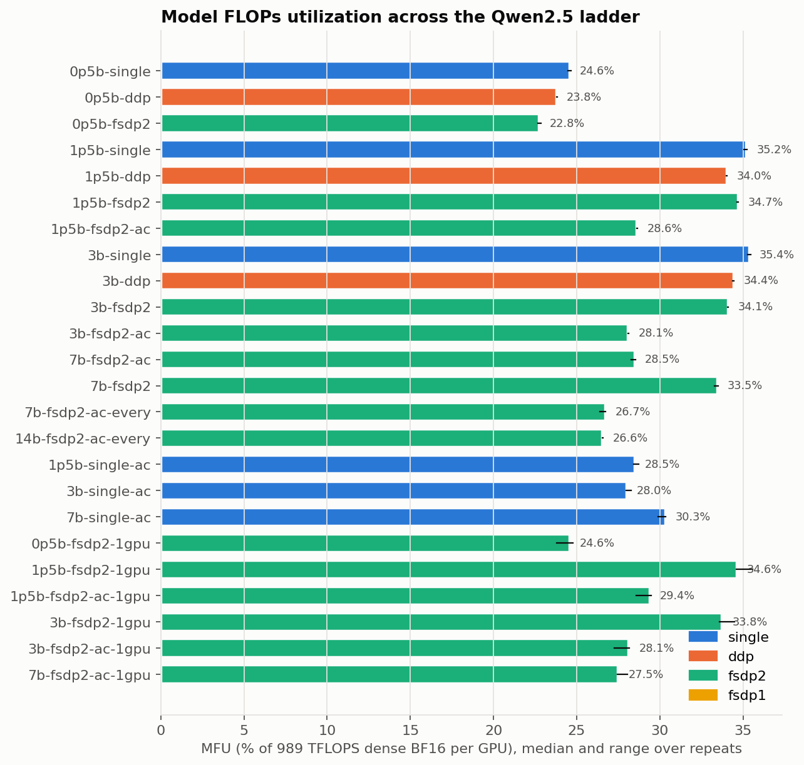
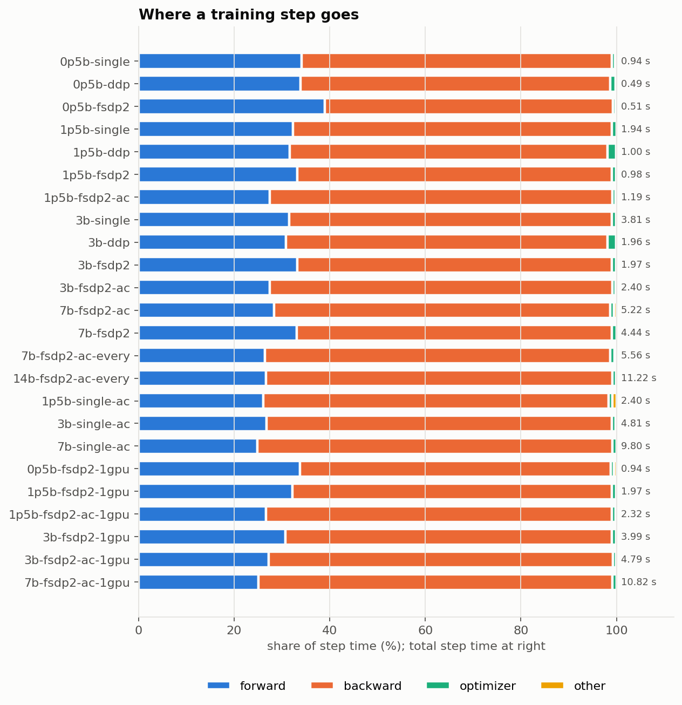
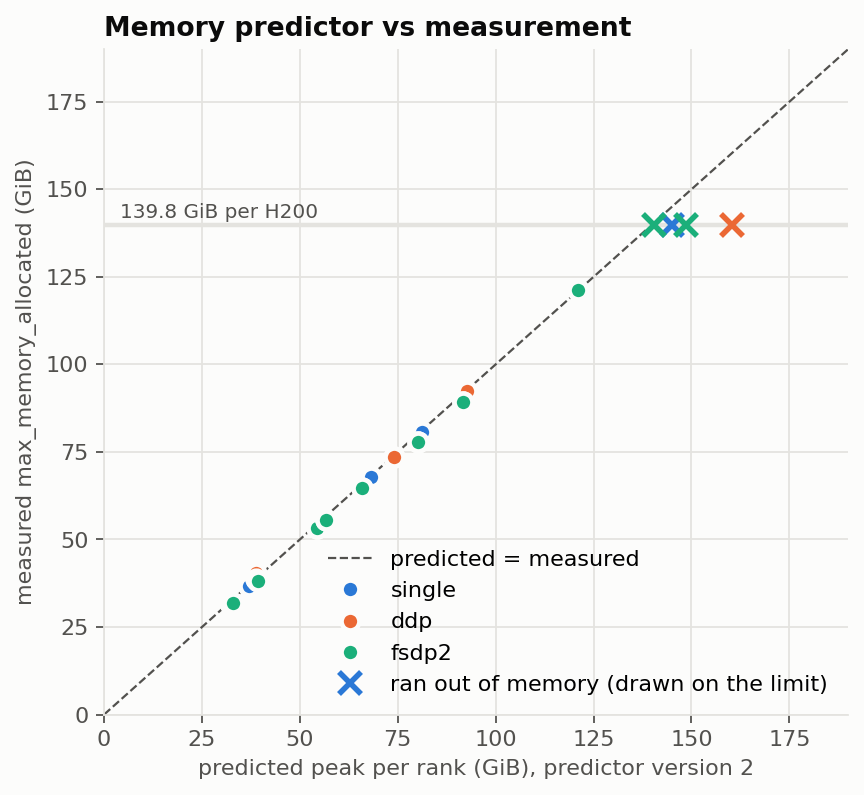

# Phase 3: full-parameter scaling and memory study

Qwen2.5 0.5B, 1.5B, 3B, 7B and 14B, full-parameter training from the pretrained weights on 1 and 2
H200s. Sweep file [configs/sweeps/p3_ladder.yaml](../configs/sweeps/p3_ladder.yaml), run by
[src/dlt/sweep.py](../src/dlt/sweep.py) in jobs 12073550 (first pass, 58 runs, 73 min),
12075847 (the single-GPU checkpointing runs, redone after a bug fix) and 12082451 (FSDP2 on 1 GPU),
2026-11-22 and 23. The tables are generated into the README ("Scaling and memory study") from
[results/train/](../results/train/).

## 1. Setup

- **Fixed for every run:** pretrained weights at pinned revisions, FineWeb-Edu packed into 2,048-token
  sequences (no padding), global batch 32 sequences = 65,536 tokens per optimizer step, FP32 master
  weights and AdamW state, BF16 compute, the same data order (seed 0).
- **Per model:** the micro-batch is the largest that fits the single-GPU or DDP baseline (4 for 0.5B and
  1.5B, 2 for 3B, 1 for 7B and 14B); accumulation fills the global batch, so it is twice as deep on 1 GPU
  as on 2.
- **Timing:** 25 steps; the first 5 are warmup and, on 2 GPUs, steps 16-17 run under the PyTorch
  Profiler (GPU kernels only) for the exposed-communication measurement. Neither is timed. CUDA events
  split each step into forward, backward (which includes any communication the step waits for) and
  optimizer.
- **Repeats:** 3 per configuration, reported as median and min-max. Consecutive 1-GPU runs ran in pairs
  on the two GPUs of one allocation (the sweep manifest records the overlap); the spread between repeats
  is under 2% almost everywhere, so pairing did not add visible noise.
- **MFU:** 6N + 12LdT FLOPs per token over the 989 TFLOPS dense BF16 datasheet peak. For context, the
  best cuBLAS GEMM measured in Phase 0 reaches 687 TFLOPS (69% of that peak).

## 2. Results

**Throughput and MFU.** 1.5B and 3B reach 34-35% MFU on 1 or 2 GPUs. 0.5B stays at 23-25%: at hidden
size 896 the GEMMs are small, and the 151,936-token output layer and its FP32 cross-entropy are a large
share of the step. 7B reaches 33.5% with FSDP2 on 2 GPUs, and 14B, which only fits with checkpointing and
per-micro-batch gradient sync, 26.6% (35.4% HFU).

**Scaling from 1 to 2 GPUs.** Each 2-GPU run is compared with the 1-GPU run that uses the same
precision mechanism: DDP with the single-GPU autocast run (96.8% at 0.5B, 96.7% at 1.5B, 97.3% at 3B),
FSDP2 with FSDP2 on one GPU (92.6%, 100.2% and 101.0%; with checkpointing 97.3% at 1.5B, 99.9% at 3B
and 103.6% at 7B). The first table compared FSDP2 against the autocast run and showed the checkpointed
pairs above 100%; FSDP2 casts parameters to BF16 once per gather instead of per op, so that mixed two
precision mechanisms, and the FSDP2 1-GPU runs (job 12082451) replaced it. FSDP2 at or slightly above
100% is real: per micro-batch the 2-GPU runs take the same time (7B: 0.322 s vs 0.335 s on one GPU),
but the optimizer step and gradient clipping run on half the parameters per GPU, and the 7B 1-GPU run
works at 122.6 of 139.8 GiB. 14B does not fit on one GPU and is reported as MFU.

**Communication.** Exposed communication (NCCL kernels running with no compute kernel alongside) is
0.01-0.02 s per step for DDP and 0.02-0.06 s for FSDP2 up to 3B, 1-3% of the step, except 0.5B FSDP2 at
10% (0.053 of 0.51 s), where the all-gathers are large next to the small layers' compute. 7B FSDP2
exposes 0.15 s of 4.4 s (3.4%), 14B 0.50 s of 11.2 s (4.5%). NCCL kernel time is far larger (1.0-1.2 s
per step for 7B, 4.2-4.9 s for 14B) because the kernels also spin while waiting; most of it overlaps
compute.

**Memory: DDP vs FSDP2.** At 3B, DDP needs 92.3 GiB per GPU (replicated FP32 state plus DDP's gradient
buckets) and FSDP2 55.5 GiB; at 1.5B, 73.5 vs 53.3 GiB. Without activation checkpointing 7B fits only
with FSDP2 (89.4 GiB on 2 GPUs).

**Activation checkpointing** (every decoder layer, transformers' non-reentrant implementation):

| | Memory saved | Throughput cost |
|---|---|---|
| 1.5B, 1 GPU / 2 GPUs FSDP2 | 39% / 40% | 19% / 18% |
| 3B, 1 GPU / 2 GPUs FSDP2 | 31% / 31% | 21% / 18% |
| 7B, 2 GPUs FSDP2 | 13% | 15% |

Recomputing the forward adds a third to the FLOPs, which at constant efficiency would cost 25% of the
throughput; the measured cost is 15-21% because the output layer, the loss, the optimizer and the
communication are not recomputed. At 7B the saving is small because memory is dominated by FSDP2's
unsharded FP32 gradient accumulation (28 GiB) and the sharded optimizer state, not activations.

**Gradient sync under accumulation (7B, checkpointing on).** Skipping the reduce-scatter on all but the
last micro-batch (the default) keeps unsharded FP32 gradients for the whole model. Syncing every
micro-batch cuts peak memory from 77.7 to 64.6 GiB (-17%) and costs 6.2% throughput, with exposed
communication rising from 0.16 to 0.33 s per step. At 14B only the per-micro-batch mode fits.

**Loading.** single and DDP load the full FP32 model on the host: 18 GiB of RSS per rank at 3B and 43
GiB at 7B. FSDP2's sharded loading ([src/dlt/train/loading.py](../src/dlt/train/loading.py)) keeps
host RSS at 2.3-5.2 GiB per rank for every size: each rank reads only its half of the safetensors bytes
(13.8 GiB at 14B) and the GPU never holds an unsharded copy. 14B loads in 14-63 s per run, depending on
how warm the /scratch cache is.

## 3. Memory predictor

[src/dlt/metrics/memory.py](../src/dlt/metrics/memory.py) predicts the peak `max_memory_allocated` per
rank from the model shape and the config, term by term (FP32 state, gradients, DDP buckets, FSDP2
gathered parameters, autocast weight copies, activations from the ops in transformers' Qwen2 code,
logits and the cross-entropy gradient). Nothing in it is fitted.

Over the 72 finished runs (the 54 of the ladder sweep and the 18 FSDP2 1-GPU baselines run later) the
current version is within 1.6% median and 4.0% worst (1.1% median on the 54 ladder runs alone), and it
called fit vs out-of-memory correctly for all 28 configurations, including the four probes placed at the
139.8 GiB limit (14B FSDP2 without checkpointing was predicted at 140.5 GiB and ran out of memory).
The model was corrected twice during the phase, each time for a mechanism found in the PyTorch or
transformers source, not by tuning a coefficient:

1. **FSDP2 no-sync accumulation** (version 2): the unsharded FP32 gradients and the sharded gradients
   never coexist at the peak, because `zero_grad(set_to_none=True)` frees the sharded ones and they
   reappear only during the last micro-batch's reduce-scatter. Version 1 counted both and over-predicted
   FSDP2 runs by up to 21%.
2. **Autocast's weight cache under checkpointing** (version 3): the cache holds a BF16 copy of every
   weight until the autocast region ends; with checkpointing nothing saves them for backward. The peak
   is then the larger of the end of the forward and the start of backward, and for 7B on one GPU it is
   the forward (13 GiB of weight copies). Version 2 kept the copies to the backward peak and
   over-predicted the 1.5B and 3B single-GPU checkpointed runs by 8-10%.

The README shows the prediction each run recorded next to today's. Both corrections came from these
runs, so the Phase 4 runs, which use configurations the model has not seen (larger micro-batches,
chunked loss, longer sequences, bucket views), are its out-of-sample check.

## 4. Bugs the measurements found

- **Activation checkpointing was silently off for single-GPU and DDP runs.** `from_pretrained` returns
  the model in eval mode and transformers checkpoints only in train mode, so the first pass measured the
  no-checkpointing configuration under a checkpointing label (identical memory and throughput gave it
  away). The engine now calls `model.train()`; a test counts layer recomputes for full and every-other-
  layer checkpointing. The 9 affected records are kept and listed in
  [results/invalid.json](../results/invalid.json), which every reader skips, and were rerun.
- **The 7B single-GPU "checkpointing" OOM** in the first pass was that bug: the run was really the
  no-checkpointing configuration (predicted 145 GiB). With checkpointing working, it fits at 129.2 GiB.
- **Paired runs overwrote each other's records** when they finished in the same second (found by the
  sweep's own test before any GPU time); run IDs now carry the process ID.
- **The first README generator never filled empty sections**, and its `--check` passed anyway (Phase 1).
