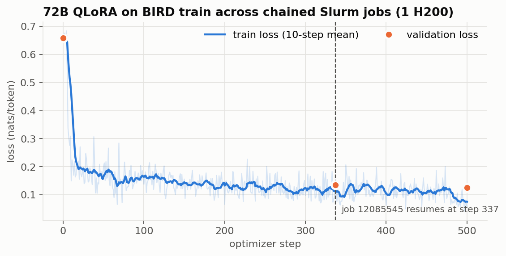
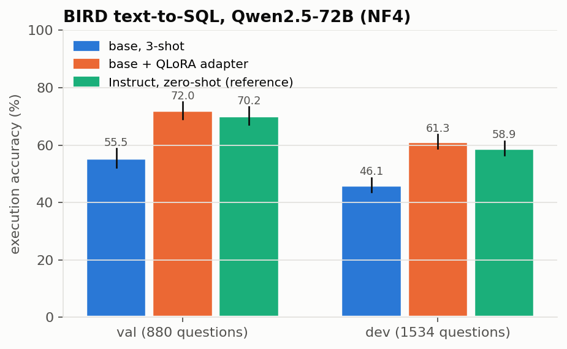

# Phase 6: Qwen2.5-72B QLoRA on BIRD text-to-SQL, one H200

## 1. Setup

- **Base:** Qwen2.5-72B in NF4 (the checkpoint saved in Phase 5, 38.4 GiB), frozen. **Adapters:** LoRA on
  all seven projections of every layer (q, k, v, o, gate, up, down), FP32, dropout 0.05 in the main run.
- **Data:** BIRD train after preparation (docs/phase5.md), one example per question: the prompt (schema
  with three sample rows per table when the example fits 4,096 tokens, else the plain schema; external
  knowledge; question) followed by the gold SQL and end-of-text. The loss covers only the SQL and the
  end-of-text token, normalized by the number of target tokens in the step. 464 of the 8,184 training
  questions (5.7%) do not fit 4,096 tokens even with the plain schema and are left out.
- **Training:** [src/dlt/train/engine.py](../src/dlt/train/engine.py) (the same engine as Phases 2-4,
  with `quant=nf4`, `peft=lora`, `task=sft`), 16 questions per optimizer step, AdamW, cosine schedule,
  activation checkpointing, BF16 compute under autocast. Adapter-only checkpoints (LoRA weights, Adam
  state, scheduler, RNG, step).
- **Evaluation:** [src/dlt/bird/evaluate.py](../src/dlt/bird/evaluate.py): batched greedy decoding, at
  most 320 new tokens, the same schema text for every model; execution accuracy by BIRD's criterion
  (same set of result rows as the gold SQL), on node-local read-only database copies with a 30 s limit
  per query, and a 95% bootstrap interval over questions. "val" is the 880-question database-level
  holdout from BIRD train used for every decision; "dev" is BIRD dev (1106 split, 1,534 questions),
  scored once per reported model. 3 dev gold queries exceed 30 s and count as wrong for every model.

## 2. Checks before the main run

**Adapter audit** (every run; job 12082455 shown): 210,534,400 trainable parameters in 1,120 tensors,
exactly r x (in + out) summed over the 560 adapted projections for r=16; every trainable tensor is a
LoRA tensor; the optimizer holds exactly those; all 963 base tensors are byte-for-byte unchanged after
the first optimizer step (two integer checksums over each tensor's raw bytes, computed on the GPU).

**Overfit test** ([configs/training/p6_overfit.yaml](../configs/training/p6_overfit.yaml), job
12082455): the first 64 training questions, 8 per step, 120 steps at learning rate 2e-4. Training loss
0.1225 at step 10, 0.0081 at 50, 0.0001 at 100, 0.0000 at 120: the adapter can memorize what it sees,
so the masking, the loss and the update all reach the model. 944 tokens/s, 28.7% MFU (QLoRA convention
4N + 12LdT), 42.8% HFU, 47.7 GiB peak.

**Short sweep** ([configs/sweeps/p6_lora.yaml](../configs/sweeps/p6_lora.yaml), job 12082456): the same
640 training questions (40 steps x 16) in every run, judged by the loss on 128 validation questions.

| Run | Validation loss after 640 questions (start 0.659) | Tokens/s | Peak GPU memory |
|---|---|---|---|
| r=16 | 0.1531 | 905 | 51.9 GiB |
| **r=64** (chosen) | **0.1466** | 905 | 61.4 GiB |
| r=16, no activation checkpointing | OOM (133.4 GiB allocated) | - | - |
| r=16, 2,048-token limit (939 questions dropped, plain schemas more often) | 0.1537 | 836 | 47.6 GiB |
| r=16, memory-efficient SDPA instead of FlashAttention | 0.1511 | 867 | 51.9 GiB |

The two r=16 runs that differ only in the attention kernel land 0.002 apart, a measure of run-to-run
noise; r=64's 0.0065 lower loss is three times that, at the same throughput and 9.5 GiB more memory,
so the main run uses r=64. 4,096 tokens keeps the schema-with-rows prompts dev is evaluated with (dev
prompts reach 4,246 tokens).

## 3. Baselines

Same prompt format and scorer for every model; the base model gets 3 worked examples (question,
knowledge, SQL) from other training databases, the Instruct model none (chat template).

| Model | val (880) | dev (1,534) | dev: simple / moderate / challenging | dev SQL that fails to execute |
|---|---|---|---|---|
| Qwen2.5-72B base, 3-shot | 55.5% (52.2-58.8) | 46.1% (43.6-48.6) | 56.9 / 38.6 / 20.3 | 332 |
| Qwen2.5-72B-Instruct, zero-shot (reference) | 70.2% (67.2-73.3) | 58.9% (56.5-61.4) | 70.2 / 53.3 / 27.7 | 91 |

Both run in NF4 on one H200. The Instruct model is a reference for what Qwen's own post-training
reaches, not a baseline the fine-tune has to beat; the claim is the gain over the base model under the
same prompt and scorer. Qwen's pretraining data is not published, so absolute scores carry a
contamination caveat (BIRD dev has been public since 2023; the 2025-11 cleanup rewrote many questions
and SQL).

## 4. Main run

[configs/training/p6_main.yaml](../configs/training/p6_main.yaml): r=64, alpha=128, dropout 0.05,
learning rate 1e-4 after 20 warmup steps with cosine decay to 1e-5, gradient clipping at 1.0, no weight
decay; 16 questions per optimizer step (16 micro-batches of one question, 4,096 tokens at most), 500
steps, so 8,000 questions or 1.04 passes over the 7,720 training examples. Checkpoints every 25 steps.
The run was submitted as chained jobs on purpose, so that it crosses a Slurm job boundary
([slurm/phase6_main.sbatch](../slurm/phase6_main.sbatch), then
[slurm/phase6_finish.sbatch](../slurm/phase6_finish.sbatch), which finishes training and runs every
fine-tuned evaluation in the same 8 h job).

| Slurm job | Steps | How it ended | Start-up | Median step (min-max) | Tokens/s | MFU (HFU) | Peak GPU allocated / reserved |
|---|---|---|---|---|---|---|---|
| 12084761 | 0-337 | USR1 300 s before the 3 h limit: checkpoint at step 337 (39 s), validation, exit 0, 2 min 20 s after the signal | 58 s model load | 28.4 s (19.8-39.3) | 873 | 26.3% (39.3%) | 61.7 / 121.6 GiB |
| 12085545 | 337-500 | finished; adapter exported | 376 s model load + 430 s restore | 28.9 s (20.7-35.9) | 874 | 26.3% (39.3%) | 61.7 / 117.4 GiB |

- **Loss:** the 10-step mean of the training loss falls from 0.67 to 0.19 in the first 20 steps, then
  slowly to 0.11 by step 480. Validation loss (the same 128 val questions as the sweep) goes from 0.659
  to 0.135 at step 337 and 0.125 at step 500. The last 17 steps begin the second pass over the data, and
  their training loss drops to 0.076 on questions the adapter has already seen; validation loss at step
  500 is still below step 337's, so at 1.04 passes there is no sign of overfitting yet.
- **The job boundary:** the second job picked up the step-337 checkpoint (adapter weights, both Adam
  moments, scheduler, RNG, step) and the data order, which is a function of the seed and the step, so it
  continued the same run: same learning-rate schedule, same examples, loss continuous across the
  boundary. Bit-exactness of exactly this mechanism is tested in Phases 2 and 8; a second, uninterrupted
  72B run to compare against would cost another 4.7 GPU-hours and was not made.
- **Restart cost:** 13.4 min in the second job. The 38.4 GiB NF4 base took 376 s to read (58 s in the
  first job, which ran on the same node right after the overfit test and the Phase 8 72B job had read
  the same files into its page cache; the second job started 2.6 h later), and the 10.5 GiB
  adapter restore took 430 s, against 23-25 s for the 3.4 GiB r=16 checkpoint in Phase 8. Cold reads from
  the shared filesystem are the likely cause of both; it was not measured further.
- **Throughput:** 873 tokens/s and 26.3% MFU, against 905 tokens/s in the 640-question r=64 sweep run. The forward pass takes 9.3 s and the backward pass 19.1 s per step (the backward
  includes the checkpointed forward recompute); the optimizer step over 842M parameters takes 0.01 s.
  Step time follows the lengths of the 16 prompts in the step.
- **Memory:** 61.7 GiB allocated at the peak, but PyTorch reserved up to 121.6 GiB: every micro-batch has
  a different length, so the caching allocator keeps blocks of many sizes. Nothing ran out of memory, but
  a second process would not fit beside it.
- **Checkpoints:** 21 saves of 10.46 GiB (the adapter and its optimizer state), median 53.3 s
  (27-78 s), all synchronous: 17.8 min in all, 7.5% of the training time. The 25-step interval was set
  from the 12 s save of the r=16 adapter. For a 53 s save at one failure a day, Young's interval is about
  50 min (about 106 steps) for a 3.5% expected overhead, and asynchronous saves (35 s down to 1.9 s per
  18 GiB save in Phase 8) would likely remove most of the stall; neither was tried on this run.
- **Wall clock:** 4.65 GPU-hours of training in two jobs (2 h 57 min and 1 h 42 min, of which 14 min was
  start-up), plus 2 h 38 min in the queue between them.

## 5. Fine-tuned results

The step-500 adapter, the only one evaluated, on the NF4 base with the same schema text and scorer as
the baselines and no worked examples (job 12085545). Nothing was chosen on dev: the rank came from
validation loss in the sweep, and dev was scored once, plus the repeat below.

| Model | val (880) | dev (1,534) | dev: simple / moderate / challenging | dev SQL that fails to execute |
|---|---|---|---|---|
| Qwen2.5-72B base, 3-shot | 55.5% (52.2-58.8) | 46.1% (43.6-48.6) | 56.9 / 38.6 / 20.3 | 332 |
| **Qwen2.5-72B base + QLoRA adapter, zero-shot** | **72.0% (69.1-75.0)** | **61.3% (58.9-63.7)** | **70.6 / 58.0 / 32.9** | **54** |
| Qwen2.5-72B-Instruct, zero-shot (reference) | 70.2% (67.2-73.3) | 58.9% (56.5-61.4) | 70.2 / 53.3 / 27.7 | 91 |

Paired differences on the same questions (bootstrap over questions, 10,000 resamples, 95% interval):

| Comparison | val | dev | dev questions only the first gets right / only the second |
|---|---|---|---|
| fine-tuned minus base | +16.6 points (+13.5 to +19.7) | +15.2 points (+12.8 to +17.5) | 305 / 72 |
| fine-tuned minus Instruct | +1.8 points (-0.7 to +4.2) | +2.3 points (+0.2 to +4.5) | 166 / 130 |

- **The gain over the base model** is 15.2 points on dev and 16.6 on val, with intervals far from zero,
  from 842M trainable parameters (1.2% of the model) and 4.65 GPU-hours on one H200. It holds at every
  difficulty level: +13.7 on simple, +19.4 on moderate, +12.6 on challenging questions.
- **SQL that does not run** drops from 332 dev queries (21.6%) to 54 (3.5%), 278 fewer, against a net
  gain of 233 correct answers. The records keep only whether each answer was right, so how many of the
  repaired queries now return the right rows is not measured.
- **Against Qwen's own Instruct model** the adapter is level to slightly better: +2.3 points on dev with
  an interval that just excludes zero, +1.8 on val with an interval that includes it. The Instruct
  model's post-training is general-purpose and its prompt carries no worked examples; the comparison
  says that a BIRD-only adapter on the base model reaches what Qwen's full post-training reaches on this
  task, not that it is a better model.
- **Reproducibility:** the dev evaluation was repeated in a fresh process (load, decode, score): all
  1,534 questions scored the same and the run generated the same 85,987 tokens. Greedy decoding with a
  fixed batch order is deterministic here.
- **Cost:** one dev pass takes 47 min of generation (batches of 16, at most 320 new tokens, 56 tokens per
  question on average) plus 1-2 min of scoring, at 89 GiB peak GPU memory (dev's longer prompts; 61 GiB
  on val).
- **Caveats:** as in section 3, Qwen's pretraining data is not public, so the absolute numbers may carry
  some contamination; the gain over the base model, under the same prompt and scorer, is the claim. Every
  number here is the NF4 model (Phase 5 measured how close NF4 is to BF16). Three dev gold queries
  exceed 30 s and count as wrong for every model.
